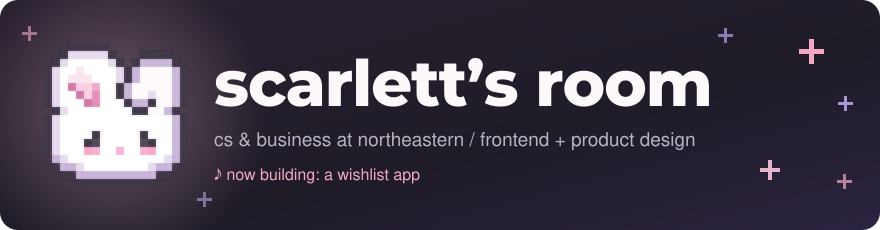
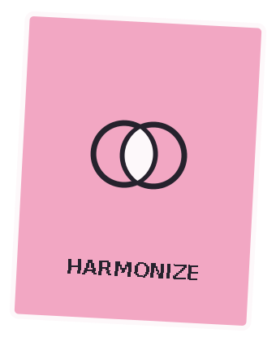
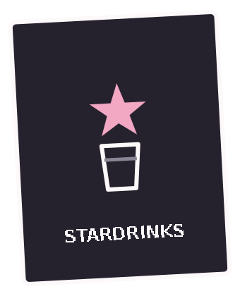

# hai there  ♡
 
 <picture>
  <source media="(prefers-color-scheme: dark)" srcset="header-dark.svg">
  
</picture>

### i'm scarlett ૮꒰ ˶• ༝ •˶꒱ა ♡ ~ !

i'm a computer science and business administration student at northeastern who likes building things that are both functional and cute. previously @ fidelity, i worked on the frontend of bond beacon, an institutional bond trading platform. outside of class, you can find me building side projects abt music and coffee, competing in valorant, or listening to way too much spotify.

### projects ⋆｡°✩

*click the banners to access project links :3*

- **harmonize** connects your spotify with a friend's and scores how compatible your music taste is
- **stardrinks** helps you find local coffee spots and save your favorites
- **wishes** is a wishlist shopping mobile app that is currently in progress...

### tech stack ⋆｡°✩⋆

 

### say hi ₍ᐢ. .ᐢ₎

